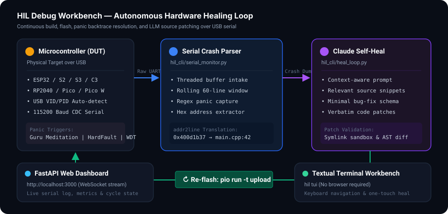

# HIL Debug Workbench

[](https://github.com/apandya55/hil_debug_workbench/actions/workflows/ci.yml)
[](https://www.python.org/)
[](LICENSE)
[](#supported-hardware)

An automated hardware-in-the-loop debugging workbench for ESP32 and RP2040 microcontrollers. It connects to your device over USB, captures boot panics and serial crashes, maps hex registers back to C++ source lines via `addr2line`, and runs an automated patch-and-flash healing loop using Claude.

---

<p align="center">
  
</p>

---

## The Problem

Debugging embedded microcontrollers is notoriously slow. When firmware crashes on physical hardware, you rarely get a clean traceback. Instead, you get raw register dumps and hex addresses over UART:

```text
Guru Meditation Error: Core  0 panic'ed (LoadProhibited). Exception was unhandled.
Core 0 register dump:
PC      : 0x400d1b37  PS      : 0x00060030  A0      : 0x800d1c6a  A1      : 0x3ffb1f20  
...
Backtrace: 0x400d1b37:0x3ffb1f20 0x400d1c67:0x3ffb1f50 0x400d1015:0x3ffb1f70
```

Turning that dump into a solution normally requires:
1. Locating your cross-compiler toolchain binary (`xtensa-esp32-elf-addr2line` or `arm-none-eabi-addr2line`).
2. Digging out the build ELF artifact deep within `.pio/build/<env>/firmware.elf`.
3. Manually demangling and resolving each frame address to a source file and line.
4. Reading the culprit source file, modifying the bug, rebuilding, and flashing over USB.

If a bug is intermittent or surfaces only under real physical hardware conditions (DMA contention, sensor timing drift, interrupt priority inversion), developers repeat this loop dozens of times.

**HIL Debug Workbench automates the entire cycle.**

---

## How It Works

1. **Auto-Detection**: Scans available USB ports and matches vendor/product IDs (CP2102, CH340, FTDI, native ESP32-S2/S3/C3 CDC, and RP2040 Pico).
2. **Serial Crash Parsing**: A background monitor thread scans incoming lines against family-specific panic patterns (Guru Meditation, stack overflow, WDT resets, HardFaults).
3. **Toolchain Resolution**: Automatically searches PlatformIO packages (`~/.platformio/packages/`) and system PATH to resolve the target cross-compiler `addr2line`.
4. **Symbolic Backtrace**: Uses the firmware ELF binary to demangle addresses into file paths, line numbers, and inlined call frames, assembling context-aware source snippets.
5. **AI Self-Healing Loop**: Sends the crash context and relevant source code to Claude, validates the returned patch against symlink directory escapes, applies verbatim source diffs, rebuilds, and re-flashes until the board runs without crashing across the stability window.
6. **Dual Workbenches**: Includes both a real-time web dashboard (`localhost:3000`) and a full keyboard-driven terminal UI (`hil tui`).

---

## Supported Hardware

| Family | Targets | Tested Boards | USB Controllers |
| :--- | :--- | :--- | :--- |
| **ESP32** | `esp32`, `esp32s2`, `esp32s3`, `esp32c3` | ESP32-WROOM-32, ESP32-S3-DevKitC-1, NodeMCU-32S | CP2102, CP2105, CH340, CH9102, FT232R, Native USB |
| **RP2040** | `rp2040` | Raspberry Pi Pico, Pico W, Adafruit Feather RP2040 | Raspberry Pi Pico SDK CDC, MicroPython CDC |

---

## Installation

### Prerequisites
- Python 3.11 or higher
- [PlatformIO Core](https://docs.platformio.org/en/latest/core/installation/index.html) (`pip install platformio` or installed via VS Code extension)
- Anthropic API key (required for `hil heal` command): `export ANTHROPIC_API_KEY=sk-ant-...`

### Install from Source
```bash
git clone https://github.com/apandya55/hil_debug_workbench.git
cd hil_debug_workbench

# Create a virtual environment
python3 -m venv .venv
source .venv/bin/activate

# Install with development dependencies
pip install -e ".[dev]"
```

---

## Quickstart

### 1. Initialize Configuration
Generate your `hil.yaml` file from the provided example:

```bash
cp hil.yaml.example hil.yaml
```

Update `hil.yaml` with your PlatformIO project location and target environment:

```yaml
version: 1

boards:
  - name: dev-esp32
    target: esp32
    pio_env: esp32dev
    pio_project_dir: /Users/username/Projects/my_firmware
    firmware_elf: .pio/build/esp32dev/firmware.elf
    baud_rate: 115200
    stability_window: 30
    max_heal_cycles: 5

dashboard_port: 3000
ai_model: claude-3-5-sonnet-20241022
ai_max_tokens: 4096
```

### 2. Detect Connected Boards
Check that your board is recognized over USB:

```bash
hil detect
```

Output:
```text
┏━━━━━━━━━━━━━━━┳━━━━━━━━━━━━━━━━━━━━━━━━━━━━┳━━━━━━━━┳━━━━━━━━━━━┓
┃ Port          ┃ Board                      ┃ Family ┃ VID:PID   ┃
┡━━━━━━━━━━━━━━━╇━━━━━━━━━━━━━━━━━━━━━━━━━━━━╇━━━━━━━━╇━━━━━━━━━━━┩
│ /dev/ttyUSB0  │ ESP32 (Silicon Labs CP2102)│ esp32  │ 10C4:EA60 │
└───────────────┴────────────────────────────┴────────┴───────────┘
```

### 3. Flash Firmware
Compile and upload using PlatformIO directly:

```bash
hil flash
```

### 4. Run the Autonomous Healing Loop
Start the iterative flash-monitor-analyze-patch cycle:

```bash
export ANTHROPIC_API_KEY="sk-ant-..."
hil heal
```

When a panic occurs, `hil` parses the backtrace, queries Claude for a targeted fix, modifies your code inside your PlatformIO project, re-flashes, and observes the board until it stays stable for 30 consecutive seconds.

---

## CLI Reference

```bash
hil [COMMAND] [OPTIONS]
```

| Command | Description | Common Flags |
| :--- | :--- | :--- |
| `hil detect` | Scan and list connected ESP32 and RP2040 microcontrollers. | `--family [esp32\|rp2040]` |
| `hil flash` | Build and upload firmware via PlatformIO. | `-c hil.yaml`, `-b <board_name>`, `-p <port>` |
| `hil monitor` | Open interactive serial monitor with panic detection. | `-c hil.yaml`, `-b <board_name>`, `--timeout <seconds>` |
| `hil heal` | Launch the autonomous self-healing loop. | `-c hil.yaml`, `-b <board_name>`, `-p <port>` |
| `hil dashboard` | Start the local FastAPI/WebSocket web interface. | `-c hil.yaml`, `-p 3000` |
| `hil tui` | Start the full-screen terminal interface. | `-c hil.yaml` |

---

## Web Dashboard & Terminal Interface

### Web Dashboard (`hil dashboard`)
Access the dark-mode browser workbench at `http://localhost:3000`. Features include:
- Real-time streamed serial monitor over WebSockets.
- Live pipeline state indicator (`IDLE`, `FLASHING`, `MONITORING`, `ANALYZING`, `AI_FIXING`, `APPLYING`, `STABLE`).
- Crash log history with one-click backtrace inspection.
- Flash and Self-Heal triggers.

### Textual TUI (`hil tui`)
For headless servers or pure terminal workflows:
- `f` — Trigger firmware flash
- `m` — Start raw serial monitoring
- `h` — Launch AI self-healing cycle
- `s` — Stop current operation
- `c` — Clear serial log view
- `q` — Quit

---

## Configuration Schema (`hil.yaml`)

```yaml
version: 1

boards:
  - name: esp32-sensor-node
    target: esp32s3                   # Supported: esp32, esp32s2, esp32s3, rp2040
    port: /dev/ttyACM0                 # Optional: omit to auto-detect by VID/PID
    baud_rate: 115200                 # Serial baud rate
    pio_env: esp32-s3-devkitc-1        # Matches [env:...] name in platformio.ini
    pio_project_dir: ./firmware       # Root directory of your PlatformIO project
    firmware_elf: .pio/build/esp32-s3-devkitc-1/firmware.elf
    stability_window: 30              # Seconds without a crash to qualify as stable
    max_heal_cycles: 10               # Maximum iteration cycles before halting

dashboard_port: 3000                  # Web dashboard HTTP port
ai_model: claude-3-5-sonnet-20241022  # Anthropic model identifier
ai_max_tokens: 4096
```

---

## Testing & Quality

Run the test suite locally:

```bash
# Run all unit and mock integration tests
pytest

# Run with coverage report
pytest --cov=hil_cli --cov=dashboard --cov=tui

# Code formatting and linting
ruff check .
ruff format --check .

# Static type checking
mypy hil_cli dashboard tui --ignore-missing-imports

# AST vulnerability analysis
bandit -r hil_cli dashboard tui -c pyproject.toml
```

---

## Contributing

Contributions, bug reports, and hardware support extensions are welcome! Check out [CONTRIBUTING.md](CONTRIBUTING.md) for local development instructions, test guidelines, and PR expectations.

---

## Security

For security vulnerability reporting and responsible disclosure, please refer to [SECURITY.md](SECURITY.md).

---

## License

This project is licensed under the [MIT License](LICENSE).
